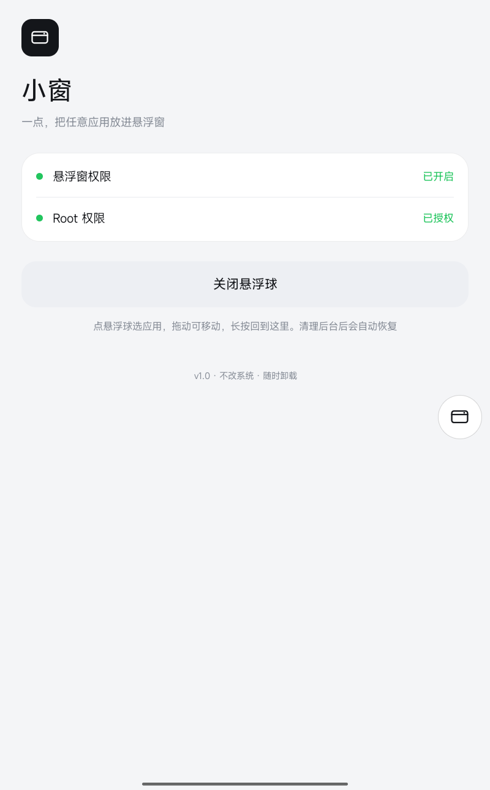
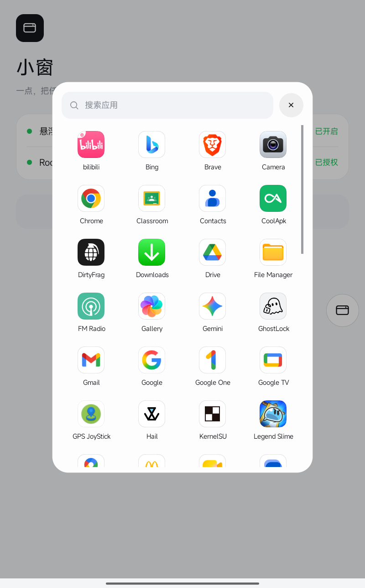

# 小窗 · FloatWin

[](https://github.com/nestchao/floatwin/actions/workflows/build.yml)
[](https://github.com/nestchao/floatwin/releases)
[](LICENSE)

> 一点，把任意应用放进悬浮窗。

在已 root 的 Android 设备上，用一个常驻悬浮球把任意应用以 **freeform 悬浮窗**打开。
48 KB，零第三方依赖，没有 `INTERNET` 权限，不收集任何数据。

| 主界面 | 应用面板 | 悬浮窗 |
|---|---|---|
|  |  |  |

## 特性

- **悬浮球**：可拖动、松手吸边；点按开面板，长按回主界面
- **应用面板**：全部已安装应用、实时搜索、4 列网格
- **真悬浮窗**：`freeform` 窗口叠在其他应用上方，不是画中画、不是分屏
- **后台保活**：MIUI「清理后台」后自动恢复（root 守护进程）
- **快捷入口**：常驻通知、快速设置磁贴、`am` 命令行/自动化 intent
- **极简**：纯 framework API，无 AndroidX，无 Gradle，构建产物 48 KB

## 要求

| 项目 | 要求 |
|---|---|
| 系统 | Android 10+（minSdk 29），targetSdk 36 |
| Root | 需要。KernelSU / Magisk 均可，App 通过 `su` 执行 `am` 命令 |
| 系统能力 | 支持 `freeform`（AOSP 原生支持；MIUI/HyperOS 只是隐藏了入口） |
| 已测试 | Redmi Pad SE 8.7 · HyperOS 3（Android 16）· KernelSU |

## 安装

1. 从 [Releases](https://github.com/nestchao/floatwin/releases) 下载 `floatwin.apk`，或自行构建
2. 安装：

   ```bash
   adb install -r -t floatwin.apk
   ```

   MIUI/HyperOS 拦截 `adb install`（`INSTALL_FAILED_USER_RESTRICTED`）时用 root 装：

   ```bash
   adb push floatwin.apk /data/local/tmp/ && \
   adb shell su -c 'pm install -r -t /data/local/tmp/floatwin.apk'
   ```

3. **授权悬浮窗**：打开 App 点「开启悬浮球」，按提示开启；或直接
   `adb shell su -c 'appops set com.local.floatwin SYSTEM_ALERT_WINDOW allow'`
4. **允许 Root**：KernelSU →「超级用户」→ 找到「小窗」→ 打开 Superuser 开关，
   回到 App 点「检测」，Root 变绿即可

## 使用

- **点悬浮球** → 应用面板 → 选应用，应用以悬浮窗打开
- **拖动悬浮球** → 任意位置，松手自动吸边
- **长按悬浮球** → 回到主界面
- **面板搜索** → 输入拼音/英文/中文均可匹配应用名
- 通知栏和快速设置磁贴都可以开关悬浮球

### 自动化

```bash
# 打开悬浮球
adb shell am start -n com.local.floatwin/.MainActivity --es action start

# 直接把某个包开成小窗
adb shell am start -n com.local.floatwin/.MainActivity --es action open --es pkg com.tencent.mm

# 关闭悬浮球
adb shell am start -n com.local.floatwin/.MainActivity --es action stop
```

## 工作原理

普通 App 无法直接创建 freeform 窗口：Android 16 上 `ActivityOptions.setLaunchWindowingMode`
属于 hidden API，反射调用会抛 `NoSuchMethodException`。所以本 App 走 root：

```bash
su -c 'am start --windowingMode 5 -n <package>/<activity> --user 0'
```

**后台保活**：MIUI 的「清理后台 / 一键清理」会直接 kill 进程（`ProcessSceneCleaner ... OneKeyClean`），
前台服务也挡不住。悬浮球启动时，App 会用 root 在 `/data/local/tmp` 起一个独立守护脚本：

- 脚本以 uid 0 运行，每 4 秒检查 `pidof com.local.floatwin`
- 进程没了就 `am start-foreground-service` 把悬浮球拉回来（实测 kill / force-stop 后 2–8 秒恢复）
- 点「关闭悬浮球」时删除 flag，守护进程自行退出

**零联网**：Manifest 里没有 `INTERNET` 权限，App 不发起任何网络请求。

## 从源码构建

依赖：**JDK 17** + **Android SDK**（build-tools、platform android-36）。

Windows（PowerShell 7）：

```powershell
.\build.ps1              # 构建
.\build.ps1 -Install     # 构建 + 安装 + 授权悬浮窗
.\build.ps1 -Run         # 构建 + 安装 + 启动
```

Linux / macOS：

```bash
chmod +x build.sh
ANDROID_SDK_ROOT=$HOME/Android/Sdk ./build.sh
```

产物：`dist/floatwin.apk`。构建不依赖 Gradle：`aapt2 → javac → d8 → zipalign → apksigner`。

## 已知限制

- **窗口没有标题栏**：窗口装饰由 ROM 决定。这台平板的 HyperOS 没有给 freeform 窗口画 MIUI 小窗顶栏，
  只有圆角与阴影；关闭请用最近任务或应用内返回
- **必须 root**：非 root 路线在 Android 16 上不可用（hidden API）
- 重装 APK 会重置 `appops` 与运行时权限，需要重新授权
- 临时 root（KernelSU LKM / exploit）重启后消失，守护进程也会随之退出，需要重新获取 root

## FAQ

**会不会收集数据？**
不会。没有 `INTERNET` 权限，没有统计 SDK，所有逻辑都在本地。

**为什么必须 root？**
见上文「工作原理」。没有 root 只能做到"打开应用"，无法指定 `freeform` windowing mode。

**支持哪些 ROM？**
理论上任何支持 freeform 的 Android 10+ 设备。已在 HyperOS 3（Android 16）验证；
AOSP / Pixel Experience 等类原生系统通常默认开启 freeform，体验更完整。

**安全吗？**
代码全部开源，root 只用于两件事：执行 `am` 命令、启动保活脚本。没有守护后门，不联网。

## 贡献

欢迎 Issue / PR。提 PR 前请确认 `build.ps1`（或 `build.sh`）能构建通过。

## License

[MIT](LICENSE)

---

### English

A 48 KB root-only launcher that opens any app in a **freeform floating window** on Android 10+.
Tap the bubble → pick an app → it opens as a freeform window above everything.
Includes search, drag-to-snap bubble, QS tile, `am` automation intents, and a root watchdog
that brings the bubble back after MIUI's "clear all" kills the process.

Requires root (KernelSU/Magisk) and a ROM with freeform support.
Tested on Redmi Pad SE 8.7 / HyperOS 3 / Android 16.

Build: `./build.sh` (Linux/macOS) or `.\build.ps1` (Windows), JDK 17 + Android SDK 36.
